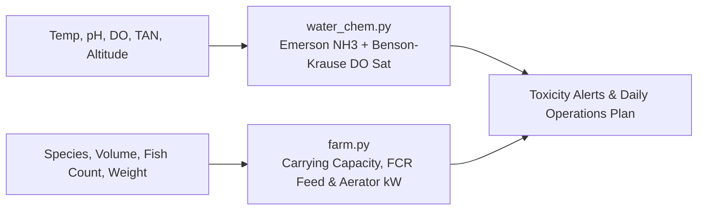

# aqua-opt

[](https://github.com/codesphere-u/aqua-opt/actions/workflows/ci.yml)
[](LICENSE)
[](pyproject.toml)
[](pyproject.toml)

**Zero-dependency aquaculture water-quality & pond optimization toolkit: Emerson un-ionized NH3 toxicity equilibrium, elevation-adjusted Benson-Krause dissolved oxygen saturation, aerator kW sizing, and tilapia/catfish FCR feeding planner.**

- **Mission Domain:** Aquaculture, Blue Economy & AgriTech
- **Stack:** Pure Python 3.11+ (zero runtime third-party dependencies, `mypy --strict`, `ruff`, `pytest`)
- **Maintainer:** Codesphere Innovations (U) Limited (`codesphere-u`)

---

## Problem Solved

Smallholder Nile tilapia and catfish farms around Lake Victoria (1,134 m altitude) suffer catastrophic overnight fish kills from afternoon high-pH un-ionized ammonia spikes and unmodeled altitude-reduced dissolved oxygen saturation.

## Key Features

- Emerson et al. (1975) un-ionized ammonia (`NH3`) equilibrium toxicity calculator (`unionized_ammonia_mg_l`, `audit_pond_chemistry`) catching lethal high-pH afternoon TAN conversions and nitrite brown-blood risk.
- Benson-Krause (1984) altitude- and salinity-adjusted dissolved oxygen saturation (`dissolved_oxygen_saturation_mg_l`) accounting for East African highland barometric drop.
- Species carrying-capacity, nighttime oxygen-demand paddlewheel aerator kW sizing, TAN excretion load, and stage-based crude-protein/FCR feeding schedules (`plan_pond_operations`) for Nile tilapia, African catfish, and rainbow trout.

## Architecture Overview



See [docs/architecture.md](docs/architecture.md) for module-level design details.

## Installation

```bash
git clone https://github.com/codesphere-u/aqua-opt.git
cd aqua-opt
uv sync --extra dev
```

Or install in editable mode with standard `pip`:

```bash
pip install -e ".[dev]"
```

## Quick Start (CLI)

```bash
aqua-opt --species nile_tilapia --volume-m3 600 --fish-count 3000 --avg-weight-g 250 --ph 7.6 --tan-mg-l 0.8
```

## Quick Start (Python API)

```python
from aqua_opt import dissolved_oxygen_saturation_mg_l, unionized_ammonia_mg_l

assert unionized_ammonia_mg_l(1.0, temp_c=25.0, ph=9.0) > 0.30
assert dissolved_oxygen_saturation_mg_l(25.0, elevation_m=1134.0) < 7.5
```

## Testing & Quality Gates

```bash
uv run ruff check src tests
uv run mypy src
uv run pytest -v
```

## Security, Contributing & Roadmap

- **Security:** See [SECURITY.md](SECURITY.md) for responsible disclosure procedures.
- **Contributing:** See [CONTRIBUTING.md](CONTRIBUTING.md) and [CODE_OF_CONDUCT.md](CODE_OF_CONDUCT.md).
- **Changelog & Roadmap:** See [CHANGELOG.md](CHANGELOG.md) and [ROADMAP.md](ROADMAP.md).

## License

MIT License — see [LICENSE](LICENSE).

## Support & Contact

Open an issue on [GitHub Issues](https://github.com/codesphere-u/aqua-opt/issues) or contact `codesphereinnovationz@gmail.com`.
